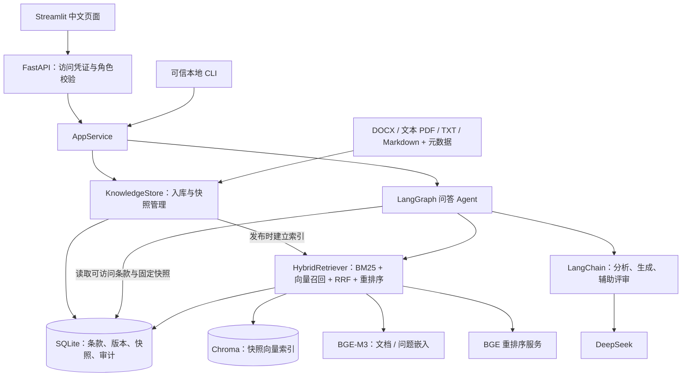
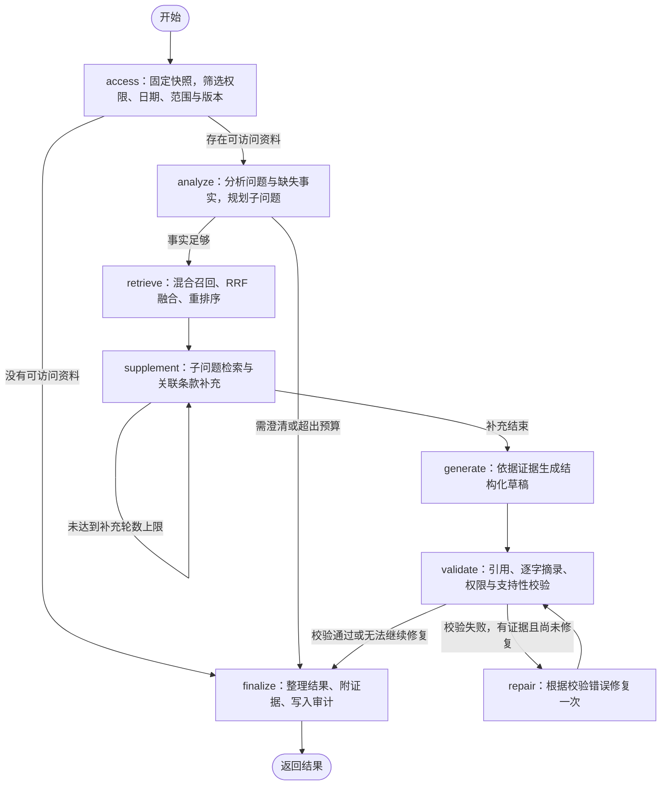

# 银行规章制度问答 Agent

本项目是基于《银行规章制度问答系统技术调研报告》实现的课程项目，采用 LangChain、LangGraph 和 RAG（检索增强生成）完成银行制度资料问答。用户提交问题后，系统按业务日期、适用范围和用户权限查找资料，再生成带证据编号的回答，并校验引用与支持性。

项目提供中文网页、HTTP API 和本地 CLI，支持文件入库、制度版本管理、知识库快照发布与回滚。目前已接入 DeepSeek 生成服务、BGE-M3 嵌入服务和 BGE 重排序服务，并导入四大行公开银行卡资料的有限事实摘要。项目定位为课程演示和技术验证，业务覆盖与评测规模见下文。

## 技术栈与职责

| 组件       | 技术                                      | 职责                       |
| -------- | --------------------------------------- | ------------------------ |
| Agent 流程 | LangGraph **Graph API**（`StateGraph`）   | 显式定义节点、状态、条件分支和有限循环      |
| 模型调用     | LangChain、`ChatOpenAI`、Pydantic         | 问题分析、结构化回答、辅助支持性评审       |
| 生成模型     | DeepSeek，兼容 OpenAI Chat Completions 的接口 | 理解问题、拆分子问题、依据检索资料生成结果    |
| 嵌入模型     | BGE-M3                                  | 将条款和问题转为向量，支持语义检索        |
| 混合检索     | Chroma、中文 BM25、RRF                      | 向量与关键词两路召回，融合候选排名        |
| 重排序      | BGE-reranker-v2-m3                      | 对已召回的“问题—条款”候选评分排序       |
| 持久化      | SQLite、Chroma 本地目录                      | 保存条款、元数据、版本、快照、审计记录及向量索引 |
| 服务与页面    | FastAPI、Streamlit                       | 提供鉴权接口、制度问答和知识库管理页面      |
| 开发检查     | pytest、Ruff                             | 测试与静态检查                  |

LangGraph 使用 **Graph API**，具体定义位于 `bank_agent/agent.py`。LangChain 的 `function_calling` 是一种可选模型结构化输出方式，与 LangGraph 的 Functional API 是不同概念。

## Agent 架构图

### 系统组成



入库与问答分开：导入先登记条款，发布时调用嵌入模型建立索引；问答时调用问题嵌入、重排序和生成服务。每次问答固定一个知识快照，避免处理中途发布造成证据版本变化。

### LangGraph 节点与分支



补充检索最多 **2 轮**；一次问题最多使用 **4 个子问题**，子问题检索发生在首轮，后续轮次继续补充关联条款。回答修复最多 **1 次**，再次失败返回 `review_required`。模型调用或检索异常也会返回需复核状态。这些上限由程序控制。

检索只在本次可访问资料中进行，补充条款也重新检查权限与日期。辅助支持性评审使用同一个配置的生成模型。最终制度性主张须逐字对应本次知识库证据；公开摘要的引用校验针对摘要文本，官方内容通过来源链接核对。

## 当前知识库内容

以下为 **2026-10-12 本地入库与发布时**的统计，后续导入会改变数量。完整知识库位于 `.env` 的 `DATA_DIR`，本次使用 `data/`。

| 类别          | 文档版本数  | 检索块数   | 用途                      |
| ----------- | ------:| ------:| ----------------------- |
| 四大行公开资料事实摘要 | 7      | 28     | 演示银行卡申领条件、材料、代理及启用等资料问答 |
| 虚构教学制度      | 3      | 11     | 验证新旧版本、业务日期、角色和机构权限     |
| 合计          | **10** | **39** | 含历史版本，不代表每次查询都能访问全部内容   |

公开资料每份含 **3 个事实整理条目**，共 **21 项**；解析器还保留每份的标题与说明块，因此入库是 **28 个检索块**。这 7 份材料是简短原创摘要，均标记为 `document_type=public`、`content_kind=summary`，不包含章程全文或银行内部制度。

### 四大行公开资料

银行完整规章制度繁杂，这里作为课程项目，选取了最为高频的借记卡、信用卡相关章程。

| 银行 / 查询范围     | 摘要来源版本                | 覆盖主题                      | 来源制度生效日    |
| ------------- | --------------------- | ------------------------- | ---------- |
| 工商银行 / `icbc` | 借记卡章程（2026 年版）        | 境内个人卡范围、申领材料与审核、代办或邮寄卡启用  | 2026-06-01 |
| 农业银行 / `abc`  | 金穗借记卡章程 ABC(2022)4001 | 实名申领、代理申领后本人激活、Ⅰ/Ⅱ类户及不可透支 | 未确认        |
| 农业银行 / `abc`  | 金穗信用卡章程（2023 年版）      | 主卡资格、申请材料与担保、激活与签名        | 2023-06-17 |
| 中国银行 / `boc`  | 长城借记卡章程（2021 年版）      | 申领审查、批量或代理激活及例外、监护代办      | 未确认        |
| 中国银行 / `boc`  | 信用卡章程（2024 年版）        | 主卡资格、材料真实性、授信审核与学生补充要求    | 2024-03-31 |
| 建设银行 / `ccb`  | 龙卡借记卡章程（2018 年版）      | 申领材料与合约、法定代理特殊业务、联名卡规定    | 2018-08-15 |
| 建设银行 / `ccb`  | 龙卡信用卡章程（2024 年版）      | 主卡资格、审核额度与担保、启用           | 2024-09-02 |

摘要统一版本为 `summary-2026.10.12-v1`。其 `effective_date=2026-10-12` 表示摘要在本知识库中的可用起点；银行原制度生效日另存为 `source_effective_date`，未确认的保持空值。摘要不能用于证明整理日期之前的历史业务结论；目录日期、文件 URL 年份也不能当作原制度生效日。

正文、元数据和官方来源索引位于 [四大行公开资料包](knowledge_packages/big_four_public_2026_10_12/README.md)及 [sources.json](knowledge_packages/big_four_public_2026_10_12/sources.json)。条目编号为整理编号，不等于银行原条款编号。材料只覆盖表中少量主题，不能据此回答所有“怎么办银行卡”或银行业务问题。

本次导入记录的是用户批准入库及自动来源事实核对，未取得银行业务审核或商业使用授权。原始 `metadata/` 模板仍为 `reviewed=false`，派生入库记录保存在 [import_record.json](knowledge_packages/big_four_public_2026_10_12/reviewed/import_record.json)；资料权利状态仍为 `rights_review_pending`。上述统计和来源版本是本次整理记录，办理实际业务时应核对银行后续公告。

### 教学制度

| 教学材料        | 版本与日期                          | 查询范围            | 演示内容与权限                             |
| ----------- | ------------------------------ | --------------- | ----------------------------------- |
| 某银行数据提取管理规定 | 1.0：2025-01-01 起，2026-01-01 废止 | `data`          | 客户数据提取审批、外部提供与匿名化；员工、合规及管理员可访问      |
| 某银行数据提取管理规定 | 2.0：2026-01-01 起               | `data`          | 新增数据管理专岗复核等要求，用于版本对比                |
| 内部授权管理规定    | 1.0：2025-01-01 起               | `authorization` | 特殊授权与复核记录；限 `demo-bank` 机构的合规或管理员角色 |

教学材料均为虚构，存放于 `examples/policies/`，不能作为真实银行制度依据。只有查询勾选“包括教学示例”或 CLI 使用 `--teaching` 时才会进入候选集。

## 拿到项目后的正确启动方法

以下命令适用于 **Windows PowerShell**，示例项目位置为 `E:\bankAgent`，请替换为自己的路径。推荐安装 **Python 3.12 x64**；项目声明支持 Python 3.11～3.13，锁定依赖在 Windows x64 / Python 3.12 环境验证。

### 1. 创建新环境并安装依赖

在项目根目录打开终端。从其他电脑复制项目时，不使用旧 `.venv`，应在新电脑重新创建；如已复制，先移除新电脑项目中的旧 `.venv` 文件夹。

```powershell
Set-Location E:\bankAgent
python --version
python -m venv .venv
.\.venv\Scripts\python.exe -m pip install -r requirements.lock.txt
.\.venv\Scripts\python.exe -m pip install -e . --no-deps
```

第一条安装命令按锁文件安装依赖，第二条将当前项目以可编辑方式安装。锁文件包含 pytest、Ruff，不包含可选的本地模型依赖。需要重新解析依赖时，可改用 `.\.venv\Scripts\python.exe -m pip install -e ".[dev]"`；其他平台应按 `pyproject.toml` 在相应虚拟环境中安装并验证兼容性。无需激活环境；上述命令已明确使用项目的 Python。

PyCharm 打开项目根目录，将解释器设为新建的 `.venv\Scripts\python.exe`，Terminal 工作目录也设为项目根目录。`.env` 和相对 `DATA_DIR` 均按运行时工作目录解析。

### 2. 准备 `.env` 并选择运行方式

已有自己填写的 `.env` 时直接保留；只有缺少 `.env` 时才创建：

```powershell
if (-not (Test-Path -LiteralPath .env)) {
    Copy-Item -LiteralPath .env.example -Destination .env
}
```

按拿到的项目内容选择以下一种方式，完成后继续第 3 步。

**A. 保留当前在线配置和已发布知识库**

如果复制了完整 `data/` 和自己的已填写 `.env`，保留 `DEMO_MODE=false`、正确的 `DATA_DIR` 及原嵌入配置。当前四大行摘要已经导入发布，**不执行 `seed-demo`，也不需要再次导入或发布**。新使用者需要填写自己的模型 Key 和系统访问令牌。

在线方式需配置以下内容；模型名称以使用者服务端可用模型为准：

| 配置                                                         | 填写内容                                          |
| ---------------------------------------------------------- | --------------------------------------------- |
| `LLM_BASE_URL`、`LLM_MODEL`、`LLM_API_KEY`                   | DeepSeek 地址、模型 ID 和自己的 DeepSeek Key           |
| `LLM_STRUCTURED_METHOD`、`LLM_THINKING`                     | 本项目联调使用 `json_mode`、`disabled`                |
| `EMBEDDING_PROVIDER`                                       | `openai_compatible`                           |
| `EMBEDDING_BASE_URL`、`EMBEDDING_MODEL`、`EMBEDDING_API_KEY` | 嵌入基础地址、`BAAI/bge-m3`、自己的嵌入服务 Key              |
| `RERANKER_PROVIDER`                                        | `http`                                        |
| `RERANKER_URL`、`RERANKER_MODEL`、`RERANKER_API_KEY`         | 完整重排接口 URL、`BAAI/bge-reranker-v2-m3`、重排服务 Key |
| `API_AUTH_TOKENS_JSON`                                     | 本系统的访问令牌及身份映射，在线 API 必填                       |
| `API_URL`                                                  | 本机启动时为 `http://127.0.0.1:8000`                |
| `DATA_DIR`                                                 | 已复制知识库的目录，本次为 `data`                          |

本次嵌入地址为 `https://api.siliconflow.cn/v1`，重排地址为 `https://api.siliconflow.cn/v1/rerank`；这两项 Key 属于同一硅基流动账户时可使用同一个有效 Key。模型 Key 与页面访问令牌用途不同。可参考 [DeepSeek 与 BGE 接入指南](docs/deepseek-setup.md)和 `examples/env/deepseek-siliconflow.env.example`，但不要直接照搬指南的新目录与教学初始化步骤到已有知识库。

生成一个随机访问令牌：

```powershell
.\.venv\Scripts\python.exe -c "import secrets; print(secrets.token_urlsafe(32))"
```

将输出替换到下面占位符，写入 `.env`，不要保留占位文字：

```dotenv
API_AUTH_TOKENS_JSON='{"替换为刚生成的随机令牌":{"user_id":"local-admin","role":"admin","organization":"demo-bank"}}'
```

**B. 仅拿到源码，先做无需 Key 的离线演示**

编辑 `.env` 的对应项，使用独立目录，避免混用已有真实向量库：

```dotenv
DEMO_MODE=true
DATA_DIR=data_demo
API_AUTH_TOKENS_JSON=
API_URL=http://127.0.0.1:8000
```

然后初始化虚构教学制度：

```powershell
.\.venv\Scripts\python.exe -m bank_agent.cli seed-demo
.\.venv\Scripts\python.exe -m bank_agent.cli ask "生产环境提取客户数据有哪些审批要求？" --scope data --teaching
```

该方式使用字符哈希向量、词法重排序及确定性摘录，不调用 DeepSeek、BGE 或其他模型接口。页面查询时勾选“包括教学示例”，测试数据提取问题。匿名身份是普通员工，不能访问教学授权规定或执行管理员操作。

**C. 仅拿到源码，希望重新建立在线知识库**

先按 A 配置自己的接口和访问令牌，将 `DATA_DIR` 设为计划使用的目录。空目录需要先导入资料并 `publish`，不能直接查询四大行摘要。公开资料包的原始模板是待审核状态，重新入库步骤见其 [检查与导入说明](knowledge_packages/big_four_public_2026_10_12/README.md#检查与导入)。也可按下文“导入资料与版本管理”添加自己的已审核材料。在线模式不能执行 `seed-demo`；如需用教学文件联调，可通过通用 `ingest` / `publish` 流程导入。

### 3. 启动 API 和页面

**终端一：启动 API，保持终端运行。**

```powershell
Set-Location E:\bankAgent
.\.venv\Scripts\python.exe -m uvicorn bank_agent.api:app --host 127.0.0.1 --port 8000
```

**终端二：启动 Streamlit，保持终端运行。**

```powershell
Set-Location E:\bankAgent
.\.venv\Scripts\python.exe -m streamlit run bank_agent/ui.py --server.address 127.0.0.1 --server.port 8501 --browser.gatherUsageStats false
```

网页地址：<http://127.0.0.1:8501/>；API 文档：<http://127.0.0.1:8000/docs>；健康检查：<http://127.0.0.1:8000/health>。健康接口显示服务模式与活动快照，不验证全部模型 Key 或答案质量。

在线模式在网页左侧“访问凭证”填入 `API_AUTH_TOKENS_JSON` 中的随机令牌字符串，填令牌本身，不填整段 JSON 或模型 API Key。系统依据该令牌确定角色与机构。教学模式允许不带凭证的普通员工问答；知识库管理始终需要已配置的管理员令牌。

两个终端分别按 **Ctrl+C** 停止对应服务；PyCharm Run 窗口可点停止按钮。端口 8501 被占用时，将页面命令改为 `--server.port 8502`，访问 8502；API 端口变化时，还需同步修改 `.env` 的 `API_URL`。修改 `.env` 后重启相关进程。

`scripts/start.ps1` 也可启动 API，但不会同时启动页面；`-Seed` 仅用于离线教学模式。为方便首次复现，建议按上面的独立步骤执行。

### 4. 验证问答

当前在线知识库：关闭“包括教学示例”，业务日期设为 **2026-10-12**，在“适用范围”填写对应银行代码。银行代码属于查询范围，不能当作用户所属机构。

| 适用范围   | 测试问题                      |
| ------ | ------------------------- |
| `icbc` | 工商银行借记卡申领需要哪些材料，是否需要银行审核？ |
| `abc`  | 农业银行个人借记卡委托他人申领后需要如何激活？   |
| `boc`  | 中国银行个人信用卡主卡申请的年龄和资料要求是什么？ |
| `ccb`  | 建设银行龙卡借记卡申领时有哪些身份证明和合约要求？ |

建议先指定银行范围，避免混合不同银行的规则。公开资料回答会显示“整理摘要（非官方原文）”、证据编号和官方来源链接。

也可在本地直接测试，CLI 不需要先启动 API 或页面，单次命令结束后退出：

```powershell
.\.venv\Scripts\python.exe -m bank_agent.cli ask "工商银行借记卡需要哪些申请材料？" --scope icbc --date 2026-10-12
.\.venv\Scripts\python.exe -m bank_agent.cli snapshots
```

## 迁移与课程项目交付

迁移已有知识库前，停止原电脑中正在读写数据的 API、页面和导入命令，再复制源码及**完整 `DATA_DIR`**，包括 `knowledge.sqlite3`、`chroma/` 和仍存在的 SQLite WAL/SHM 文件。使用者自己的已填写 `.env` 可单独安全迁移，新电脑重新建立 `.venv`。

保留同一嵌入配置和完整索引时，只需安装依赖、启动服务。更换嵌入模型、地址、提供方式、修订配置或教学/在线模式，或者丢失向量索引时，需对已有条款重新执行 `publish`。仅改变项目路径或更换 API Key，不需要重建同一配置的向量索引。将 `DATA_DIR` 改为新目录后，原知识库不会自动迁入。

提交课程作业时不附带真实 `.env`、模型 Key 或系统令牌，提供配置模板即可。`.venv`、缓存及个人 IDE 配置无需交付。若需要让老师复现已发布的公开摘要问答，可附带经过检查的知识库数据目录及入库记录；`data/` 还含审计记录与运行日志，提交前检查其中是否有个人或敏感信息。纯源码也可按离线演示步骤复现。

`.gitignore` 忽略 `.env`、`.venv/` 和 `data/`，通过 Git 获取源码时通常不包含已填写配置与已发布知识库。

## 导入资料与版本管理

支持 DOCX、文本型 PDF、TXT、Markdown。管理员网页上传限制为 10 MB；扫描 PDF 需要先 OCR，当前没有内置 OCR。解析优先按“第X条”切块，保留表格信息；PDF 可保留来源页码，Word 不生成虚构页码。

参照 `examples/metadata/` 填写 `policy_id`、`version`、日期、范围、可访问角色与机构、来源、材料类型及审核信息。程序要求 `reviewed=true` 且 `reviewed_by` 非空才能导入；这些字段是审核登记，程序本身不能证明资料已获得业务认可或使用许可。网页导入时，审核人由当前管理员身份写入。

```powershell
.\.venv\Scripts\python.exe -m bank_agent.cli ingest .\your-policy.docx --metadata .\your-policy.json
.\.venv\Scripts\python.exe -m bank_agent.cli publish
.\.venv\Scripts\python.exe -m bank_agent.cli snapshots
# 将 SNAPSHOT_ID 替换为上一步列出的可用快照编号
.\.venv\Scripts\python.exe -m bank_agent.cli activate SNAPSHOT_ID
```

导入形成登记草稿，**发布后才进入新快照供问答使用**。同制度同版本内容与登记信息不可覆盖，修订应使用新版本号。索引构建成功后才切换活动快照，失败保留原活动快照，旧快照可回滚。`expiry_date` 是不再有效的第一天；查询按业务日期和权限选择适用版本。

`DEMO_MODE` 控制模型实现，“包括教学示例”控制检索材料，两者独立。例如在线模型也能查询通过通用导入流程登记的教学文件。CLI 的 `--role`、`--organization` 仅用于可信本地测试，HTTP 请求的身份由服务端令牌决定。

如需本地运行 BGE，可另装 `.\.venv\Scripts\python.exe -m pip install -e ".[local]"`，再设置 `EMBEDDING_PROVIDER=local`、`RERANKER_PROVIDER=local`；首次需准备模型文件及相应硬件。`lexical` 仅是词法重排基线。HTTP 重排接口须返回所有候选的有效分数，索引不得重复；适配逻辑见 `bank_agent/providers.py`。

## 输出、接口与运行边界

| 输出状态                    | 含义                    |
| ----------------------- | --------------------- |
| `answered`              | 本次回答通过项目的引用与辅助支持性检查   |
| `clarification_needed`  | 需要补充业务事实或缩短超预算的问题     |
| `insufficient_evidence` | 无可访问资料或未检索到足够证据       |
| `review_required`       | 校验、模型调用或检索未能完成，需要人工复核 |

通过校验不等于业务判断一定正确。最终回答以可核对的资料摘录为主，附版本、日期、证据 ID、快照 ID 和检查结果；完整校验后一次返回，不流式发布未校验草稿。

| 方法与路径                                          | 用途            |
| ---------------------------------------------- | ------------- |
| `GET /health`                                  | 服务模式与活动快照     |
| `POST /ask`                                    | 问答            |
| `GET /evidence/{evidence_id}`                  | 按权限、日期与范围查阅证据 |
| `POST /admin/documents`                        | 管理员上传已审核资料    |
| `POST /admin/publish`                          | 发布快照并构建索引     |
| `GET /admin/snapshots`                         | 查看快照          |
| `POST /admin/snapshots/{snapshot_id}/activate` | 激活可用快照        |

需鉴权的请求使用 `X-API-Key`。普通问答请求不接收角色字段。在线模式未配置身份映射时，相关接口返回 503；访问令牌缺失或无效返回 401，非管理员执行管理操作返回 403。

会话按用户、角色、机构和会话 ID 隔离，只保留用户提供的问题与事实，后续制度依据重新检索。会话保存在进程内，重启清空，当前没有共享会话存储。审计记录节点、检索轨迹、证据、版本、校验及调用消耗；**规则脱敏发生在审计日志写入前**，用户输入、历史消息和知识库证据可能直接发送给配置的模型服务。未配置实际 tokenizer 时，上下文按 UTF-8 字节作保守预算，不是精确计费 token 数。

课程版本采用本地存储、静态令牌和单进程会话，问答在进程内串行执行，未验证高并发部署。没有银行业务系统集成、自动监管资料同步或扫描件 OCR；更大规模语料、权限系统、共享会话、性能及业务正确率评测仍需扩展。

## 测试与评测

测试覆盖版本和有效日期、机构及角色隔离、教学标识、快照发布、混合检索、引用失败修复、会话隔离、API 鉴权和摘要来源字段；结构化模型调用使用模拟服务测试。

```powershell
.\.venv\Scripts\python.exe -m pytest -q
.\.venv\Scripts\python.exe -m ruff check .
```

教学回归评测使用 `.env` 指定的知识库和模型配置。先初始化对应教学资料，再运行；教学模式无需模型 Key，在线模式会调用配置的模型服务：

```powershell
.\.venv\Scripts\python.exe -m bank_agent.evaluation --dataset examples/evaluation.jsonl --output data/evaluation.json
```

2026-10-12 的四大行在线问答联调记录见 [live_validation.json](knowledge_packages/big_four_public_2026_10_12/reviewed/live_validation.json)：四个样例均返回 `answered`，并检查银行范围和摘要标识。少量成功样例与回归指标不能代表整个银行业务的准确率。调研报告中的约 20～30 份正式文件、300 条业务审核评测集及准确率目标尚未完成，不能当作本项目已取得的结果。

## 项目目录

```text
bankAgent/
├── bank_agent/            # Agent、检索、存储、模型适配、API 与页面
├── docs/                  # 模型接入说明与可导出的 Agent Mermaid 图
├── examples/              # 教学正文、元数据、环境模板、评测样例
├── knowledge_packages/    # 四大行摘要、来源索引与入库记录
├── scripts/               # 启动脚本、公开资料包检查与导入脚本
├── tests/                 # 自动化测试
├── data/                  # 本次在线知识库；实际位置由 DATA_DIR 决定
├── .env.example           # 配置模板
├── pyproject.toml         # 项目信息与依赖声明
├── requirements.lock.txt  # 已验证环境的依赖版本
└── README.md
```

节点实现图还可通过 `.\.venv\Scripts\python.exe -m bank_agent.cli graph` 导出到 `docs/agent-graph.mmd`。实现参考：[LangGraph Graph API](https://docs.langchain.com/oss/python/langgraph/graph-api)、[LangChain ChatOpenAI](https://docs.langchain.com/oss/python/integrations/chat/openai)、[Chroma Collection API](https://docs.trychroma.com/reference/python/collection)。
