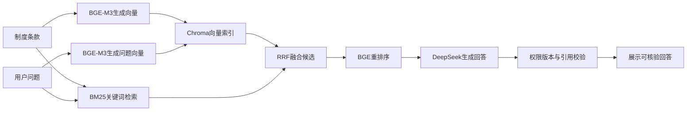

# DeepSeek 与 BGE 模型接入指南

建议先使用 DeepSeek 生成 API，加上硅基流动提供的 BGE-M3 嵌入 API 和 BGE 重排序 API。这样不需要在个人电脑下载和部署三个模型。本方案需要一个 DeepSeek Key、一个硅基流动 Key；后者分别填写到两个 BGE 服务的 Key 字段。

## 三个模型做什么

嵌入模型把文本变成一组数字。导入制度时，为每个条款生成向量并保存到 Chroma；用户提问时，也为问题生成向量，以语义相似度寻找候选条款。例如“把客户资料给供应商可以吗”可以匹配“向外部合作方提供客户级数据”的条款，即使措辞不同。BGE-M3 支持多语言文本；本项目先使用其稠密向量功能。[BGE-M3 官方模型卡](https://huggingface.co/BAAI/bge-m3)

重排序模型拿到“问题 + 候选条款”，逐个计算相关性，将更相关的条款放在前面。它处理的是检索已经找到的候选，无法找回没有召回的条款，其分数也不是答案正确概率。本项目使用 BGE-reranker-v2-m3。[官方模型卡](https://huggingface.co/BAAI/bge-reranker-v2-m3)

DeepSeek 读取筛选后的条款，分析条件并生成结构化回答。模型调用、制度引用和权限校验由项目代码编排。



## 获取 Key

1. 登录 [DeepSeek API Key 页面](https://platform.deepseek.com/api_keys)，创建自己的 Key。DeepSeek 当前官方入门文档列出的生成模型 ID 包括 `deepseek-flash` 和 `deepseek-v4-pro`，本指南先配置前者。[官方入门](https://api-docs.deepseek.com/guides/codex)
2. 登录 [硅基流动控制台](https://cloud.siliconflow.cn)，在 API 密钥页面创建 Key。确认账户可以使用 `BAAI/bge-m3` 和 `BAAI/bge-reranker-v2-m3`。平台模型会调整，以账户模型列表返回的名称为准。[嵌入接口](https://docs.siliconflow.cn/docs/api/embeddings-post)、[重排序接口](https://docs.siliconflow.cn/docs/api/rerank-post)
3. 确认平台账户具有调用权限和可用额度；费用以平台当前价格为准。本指南不会替你开户或调用付费接口。

## 填写项目环境变量

在 PyCharm 打开项目根目录 `.env`，参考 `examples/env/deepseek-siliconflow.env.example` 替换对应配置。保留其他已有配置，避免重复定义同一个变量。程序只自动读取根目录 `.env`，不会读取示例文件。

```dotenv
DEMO_MODE=false
DATA_DIR=data_deepseek

LLM_BASE_URL=https://api.deepseek.com
LLM_MODEL=deepseek-flash
LLM_API_KEY=填写DeepSeek的Key
LLM_STRUCTURED_METHOD=json_mode
LLM_THINKING=disabled

EMBEDDING_PROVIDER=openai_compatible
EMBEDDING_BASE_URL=https://api.siliconflow.cn/v1
EMBEDDING_MODEL=BAAI/bge-m3
EMBEDDING_API_KEY=填写硅基流动的Key

RERANKER_PROVIDER=http
RERANKER_URL=https://api.siliconflow.cn/v1/rerank
RERANKER_MODEL=BAAI/bge-reranker-v2-m3
RERANKER_API_KEY=填写同一个硅基流动的Key

MAX_OUTPUT_TOKENS=2000
TOKENIZER_MODEL=
```

DeepSeek 的 JSON 模式对应 `response_format.type=json_object`。项目已将输出字段与 JSON schema 显式提供给模型，并在本地执行 Pydantic 结构校验。`LLM_THINKING=disabled` 控制模型服务的思考模式，便于先联调结构化结果；LangGraph 的补充检索、分支和条件核对流程仍然执行。[DeepSeek 接口文档](https://api-docs.deepseek.com/api/create-chat-completion/)

嵌入字段填写基础地址 `/v1`，代码自动请求 `/embeddings`；重排序字段填写完整 `/v1/rerank`。这两个地址不可互换。切换到 `data_deepseek` 后需要重新导入和发布索引，旧目录中的教学哈希向量不会被复用。

再生成本系统自己的访问令牌。在 PyCharm 的 Terminal 中运行：

```powershell
.\.venv\Scripts\python.exe -c "import secrets; print(secrets.token_urlsafe(32))"
```

把输出的随机字符串替换到下方 `这里替换为随机字符串`，写入 `.env`：

```dotenv
API_AUTH_TOKENS_JSON='{"这里替换为随机字符串":{"user_id":"local-admin","role":"admin","organization":"demo-bank"}}'
```

这一项是本系统登录身份，不是模型平台 Key。后续在 Streamlit 的“访问凭证”框填写同一个随机字符串。

## 初始化知识库并启动

先使用项目自带的虚构教学制度联调。在 PyCharm Terminal 执行，工作目录为 `E:\bankAgent`：

```powershell
.\.venv\Scripts\python.exe -m bank_agent.cli ingest examples/policies/data-use-v2.txt --metadata examples/metadata/data-use-v2.json
.\.venv\Scripts\python.exe -m bank_agent.cli publish
.\.venv\Scripts\python.exe -m bank_agent.cli ask "生产环境提取客户数据有哪些审批要求？" --teaching
```

`publish` 会调用嵌入服务建立索引；`ask` 会调用三类模型服务。`DEMO_MODE=false` 时不能用 `seed-demo` 命令，按上面的通用导入流程即可使用教学文件。

停止已在运行的旧服务，再开两个终端分别执行：

```powershell
.\.venv\Scripts\python.exe -m uvicorn bank_agent.api:app --host 127.0.0.1 --port 8000
```

```powershell
.\.venv\Scripts\python.exe -m streamlit run bank_agent/ui.py --browser.gatherUsageStats false
```

在页面填入自己的系统访问令牌，勾选“包括教学示例”，再提问。之后可通过管理员界面导入已审核制度并发布。公开材料和教学示例可用于初期验证；真实内部材料的模型服务使用方式需符合接入银行的授权要求。

## 常见问题

| 表现 | 检查内容 |
| --- | --- |
| 401 或无效凭证 | 模型 Key 是否属于对应平台；页面访问凭证是否来自 `API_AUTH_TOKENS_JSON` |
| 403 或模型不可用 | 账户是否有该模型权限、模型 ID 是否仍在账户可用列表中 |
| 提示没有已审核制度 | 新目录是否已导入并 publish；教学文件是否勾选；业务日期是否有效 |
| 提示嵌入配置不同 | 模型、地址或模式已改变，需要发布新的知识快照 |
| 结构化结果失败 | 保持 `json_mode`，检查输出预算和 `LLM_THINKING=disabled` |
| 端口被占用 | 停止旧的 API/Streamlit 进程后重启 |

如果以后选择本地 BGE 模型，可安装 `pip install -e '.[local]'`，再设置 `EMBEDDING_PROVIDER=local`、`RERANKER_PROVIDER=local`；两项 BGE Key 可以留空。首次需下载模型，速度取决于硬件。DeepSeek 生成仍通过它自己的 API 调用。

已于 2026 年 10 月 12 日使用 11 条教学证据完成真实 API 联调：DeepSeek、硅基流动嵌入和重排序均调用成功，带访问凭证的 `/ask` 返回 `answered`，引用及支持性校验通过。完整结果保存在 `data/live-smoke-result.json`。本地 57 项测试与 Ruff 检查通过；此次联调仅验证教学问答流程。官方接口核对日期：2026 年 10 月 11 日。
